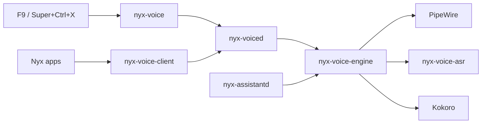

# Nyx Voice architecture

| Piece | What it is |
|---|---|
| `nyx-voice-engine` | The library: PipeWire capture (16 kHz) and playback (24 kHz), echo cancelling (PipeWire's `module-echo-cancel`), ducking other playback, Silero or energy voice activity, the streaming recognizer client, Kokoro and Chatterbox synthesis |
| `nyx-voice-asr` | The recognizer worker: NVIDIA Nemotron streaming 0.6B (int8, 560 ms chunks) through sherpa-onnx, in its own process (its ONNX Runtime must not meet the one Kokoro and Silero load, and a crash there takes nothing else down) |
| `nyx-voiced` | The service: one take at a time, dictation typed with `wtype`, speech for apps, state for bars; engines load on first use and unload after five minutes idle |
| `nyx-voice` | The command, for key bindings and scripts |
| `nyx-voice-proto`, `nyx-voice-client` | The socket protocol and its client |

## Who owns what

- Nyx Voice owns capture, voice activity, recognition, synthesis, playback and the
  speech session's lifecycle.
- The Assistant owns conversation, wake words, follow-ups, barge-in decisions and what
  to say. It links the engine in its own process, as its voice loop always ran there;
  it doesn't go through `nyx-voiced`.
- AI Core owns language models. Speech never runs in its llama.cpp worker.

Each program names itself to the engine (`paths::set_app`): the Assistant keeps its own
folders and PipeWire names (`Assistant`, `assistant-echo-cancel`); `nyx-voiced` uses
`nyx-voice`'s. Models one has downloaded are found by the other.

## Privacy

Raw audio stays in memory: nothing records it to disk. Transcripts go to the caller and
are never logged. Listening and dictation need a trusted program; the `state` file and
`watch` show when the microphone is open, and `nyx-voice stop` ends a take at once.
